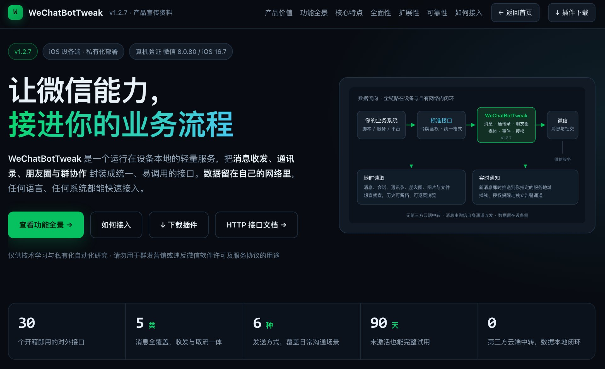

# WeChatBotTweak · 使用说明书

> **让微信能力，接进你的业务流程。**
> 面向客户与公众的公开说明 · 版本 **v1.2.11**

**项目官网**：[https://wxbottweak.kdns.fr/wechatbottweak](https://wxbottweak.kdns.fr/wechatbottweak) —— 产品价值、功能全景、接入说明与插件下载，都可在官网查看。



**WeChatBotTweak** 是运行在设备本地的轻量服务。它把消息收发、通讯录、朋友圈与群协作封装成一组统一、易调用的接口，让脚本、后端服务、低代码平台或智能体都能快速接入。消息、图片与文件都留在自己的网络里，不经过第三方云端，也不需要额外账号。

| 关键数字 | 说明 |
| --- | --- |
| 对外接口 | **35 个**，开箱即用 |
| 消息形态 | 文字 / 图片 / 语音 / 视频 / 文件 / 链接 / 表情 / 引用 / 卡片 |
| 发送方式 | **6 种**：文字、引用回复、图片、语音、视频、文件 |
| 试用 | 未激活可完整试用 **90 天** |
| 云端中转 | **0**，数据本地闭环 |
| 验证环境 | 微信 8.0.80 / iOS 16.7 真机 |

---

## 1. 它解决什么问题

不是「能不能发一条消息」，而是「能不能放心、稳定、长期地把微信纳入自己的自动化流程」。

- **数据在自己手里**：服务运行在设备本地，消息与文件不经过第三方服务器，只在受信任的网络内对外开放。
- **与手动操作一致**：消息由微信自身的收发通道完成，显示效果与手动操作一致，不需要额外账号，也不依赖模拟点击。
- **稳定长期在线**：退到后台自动保持服务，异常中断有自愈与提醒；消息既可实时推送，也可随时补拉，网络中断也不会漏掉已产生的记录。
- **接入门槛低**：标准 HTTP 接口与统一返回格式，配置在微信内可视化完成，随包附示例客户端，几步即可跑通。

```
你的业务系统  →  标准接口（令牌鉴权 / 统一格式）  →  WeChatBotTweak  →  微信
                        ↙ 随时读取：消息 / 会话 / 通讯录 / 朋友圈 / 图片 / 文件
                        ↘ 实时通知：新消息推送 / 掉线与授权提醒（独立通道）
```

---

## 2. 典型使用场景

| 场景 | 能做的事 |
| --- | --- |
| 业务通知与提醒 | 把系统告警、订单状态、审批结果送到指定会话，并把回复统一收回自己的系统 |
| 消息归集与查询 | 按会话读取最近消息、随时补拉，本地留档并设置容量上限 |
| 群内协作 | @指定成员或 @所有人、引用回复、发布群公告，群内显示名自动匹配 |
| 素材取用 | 直接取回聊天中的图片、语音、视频与文件，以及朋友圈图片与视频 |
| 内容核对 | 读取朋友圈时间线、好友主页与点赞评论明细，供内部核对与统计 |

---

## 3. 功能一览

### 消息与会话

| 能力 | 说明 |
| --- | --- |
| 全类型接收 | 文字、图片、语音、视频、文件、链接、表情、引用、卡片消息统一接入；群内 @ 自动整理为「谁被提到、是否 @ 我、是否 @ 所有人」等清晰字段 |
| 消息随时可查 | 按会话读取最近消息，本地自动留档并控制占用上限；实时推送中断也能回来补拉 |
| 媒体按需取回 | 自动匹配当前最清晰的可用版本，未就绪时在请求里主动补齐；视频、语音、文件均可直接使用 |
| 实时事件通知 | 每条新消息即时推送到指定地址；服务异常、授权到期走独立告警通道，业务消息与运维提醒互不干扰 |

### 通讯录

一次刷新拿到全量联系人，之后查询走本地缓存；列出所有群聊与群成员，自动使用群内展示名，支持按群查人、按人反查所在群；按昵称、备注或 ID 反查好友与群，结果结构统一。好友、群聊、公众号自动归类，不需要预先维护名单；查询时也可按类型筛选，一次只取某一类（好友 / 群 / 公众号 / 本企业成员 / 外部企微等）。

### 朋友圈

| 类别 | 能力 |
| --- | --- |
| 浏览 | 读取最新时间线、查看指定好友主页，支持逐页往回翻，想看最新随时回到起点 |
| 明细 | 正文、时间、作者、点赞与评论明细齐全；信息流广告默认自动剔除，也可选择保留自行处理 |
| 媒体 | 朋友圈图片可取清晰原图，视频返回可直接播放的文件 |
| 互动 | 点赞、取消赞、发表评论、删除本人评论；执行前可预演，重复提交有保护 |

### 群协作

- **六种发送**：文字、引用回复、图片、语音、视频、文件；可直接传内容，也可使用设备上已有文件。
- **@ 与提醒**：@指定成员、@所有人、引用回复叠加 @，群内显示名自动匹配。
- **群公告**：读取与发布都支持；发布默认先预演，确认后才真正通知群成员。
- **动作可控**：真实动作支持预演，非法参数直接拒绝，唯一标识让超时重试不会重复执行。
- **六种发送都可预演**：文字、引用回复、图片、语音、视频、文件在真正发出前都能先空跑一次，确认参数与目标会话无误再落地，不会「试一下」就发出去。

### 社交管理

| 能力 | 说明 |
| --- | --- |
| 群内显示名 | 修改自己在指定群里的显示名，一处设置该群立即生效，不影响其他群 |
| 好友备注 | 为好友设置或修改备注名，保存后通讯录同步可见 |
| 好友申请 | 查看待处理的好友申请（含申请留言与来源渠道）、同意加为好友、查询操作冷却状态；未同意前不会改变任何申请状态 |

### 服务与授权

- **可视化配置**：在微信「我 → 设置」中打开插件设置页，集中管理服务、消息、后台与状态。
- **后台常驻与异常提醒**：微信退到后台仍保持服务，中断自动恢复；进程被结束后有本地提醒并可同步告警。
- **授权与试用**：未激活完整试用 90 天；激活码一机一号、不可共用，到期前分阶段提醒。
- **状态可查**：随时查看版本、服务状态与微信就绪情况。

---

## 4. 交付内容

| 文件 | 说明 |
| --- | --- |
| `README.md` | 本说明书 |
| `wechatbottweak_api.md` | 对外接口文档（35 个接口 / 39 条路由），含参数、返回字段与调用示例 |
| `packages/cwwechatbot_1.2.11_rootless.deb` | 适用于 rootless 越狱环境的安装包 |
| `packages/cwwechatbot_1.2.11_rootful.deb` | 适用于 rootful 越狱环境的安装包 |
| `client/wxbot_client.py` | 示例客户端：查询、发送、媒体下载 |
| `client/webhook_receiver.py` | 实时推送接收端示例，含媒体自动回拉保存 |
| `assets/wechatbottweak-website.jpg` | 官网首页截图 |

两个安装包功能完全一致，按设备环境选择其一即可。

> **v1.2.11（2026-11-25）** —— 分类口径修正版本。通讯录企微联系人的归类更准确：
> 本企业成员与外部企微号（客服号、其它企业成员等）现在分别归入不同类别，不再把外部企微号
> 误算成自己企业的成员。**接口路径、参数与返回结构完全不变**，从 1.2.10 升级无需重新配置，
> 原有授权继续有效。

---

## 5. 安装

**运行前提**：已越狱的 iOS 设备；一个受信任的局域网或私有转发通道。不需要额外服务器或第三方账号。

1. **选择安装包**：按设备的越狱环境，从 `packages/` 中选取 `rootless` 或 `rootful` 版本。
2. **安装并启用**：安装对应安装包，完成后重启微信，服务随微信一起启动。
3. **完成配置**：在微信「我 → 设置」中打开插件设置页，设置访问令牌与推送地址。

> 建议先做一次健康检查，确认服务已就绪，再开始接入业务系统。

---

## 6. 配置

常用项都在微信「我 → 设置」中的插件设置页，可视化修改，保存后立即生效，多数改动无需重启。

| 配置项 | 说明 |
| --- | --- |
| 服务端口 | 默认 `18888` |
| 访问令牌 | 建议设置；设置后所有调用均需校验 |
| 消息推送地址 | 新消息实时推送到你的服务器 |
| 告警推送地址 | 掉线、授权等运维提醒，与消息通道独立；留空则只在设备本地提醒 |
| 后台常驻与提醒 | 退到后台保持服务，中断自动恢复并提醒 |
| 媒体自动获取 | 收到图片 / 视频 / 文件时自动准备可取回的文件 |

完整参数与字段说明见 `wechatbottweak_api.md`。

---

## 7. 三步接入

所有示例中的地址、令牌与 ID 均为占位符，请替换为实际值。

```bash
BASE="http://<设备IP>:18888"
TOKEN="<访问令牌>"

# 1) 确认服务就绪
curl -s -H "X-Token: $TOKEN" "$BASE/api/health"

# 2) 读取最近消息
curl -s -H "X-Token: $TOKEN" "$BASE/api/messages?chat=<会话ID>&limit=20"

# 3) 发送一条消息
curl -s -X POST "$BASE/api/send/text" -H "X-Token: $TOKEN" \
  -H "Content-Type: application/json" \
  -d '{"chat":"<会话ID>","text":"你好"}'
```

不限语言：标准 HTTP 接口与统一 JSON 返回格式，任何能发 HTTP 请求的系统都能接入。成功、参数错误、鉴权失败、重复请求、结果不确定等都有明确状态，便于自动重试与降级。随包提供的两个 Python 示例可直接改几行运行。

---

## 8. 试用与授权

- 未激活状态下可**完整试用 90 天**，功能不打折。
- 激活码**一机一号**，与设备绑定、不可共用；更换设备需要重新签发。
- 当前授权状态、有效期可在设置页查看，也可通过接口查询。
- 临近到期会分阶段提醒，避免业务突然中断。

---

## 9. 稳定与安全保障

1. **全类型消息，一个入口** —— 统一格式输出，业务侧不用为每种消息各写一套解析。
2. **图片视频，清晰可用** —— 自动挑最清晰的可用版本并主动补齐，不用先去手机上点开。
3. **每一步都可控** —— 真实动作先预演、非法参数直接拒绝、超时重试有重复保护，不误发、不连发。
4. **稳定在线，异常可知** —— 后台持续可用，中断自动恢复，掉线与授权状态主动提醒。
5. **返回结果干净统一** —— 成功与失败格式一致，提示语直白，不夹带内部实现信息。
6. **容量可控** —— 消息留档有自动轮转与体积上限，长期运行不会占满设备空间。
7. **升级不折腾** —— 版本升级保留原有配置，服务状态随时可核对。
8. **真机验证** —— 全部能力在真实设备上完成回归验证，两类安装包构建零错误、零告警。

---

## 10. 使用边界与合规

- 本产品仅供技术学习与私有化自动化研究，请勿用于商业群发营销、骚扰或任何违反《微信软件许可及服务协议》的行为，使用者需自行承担相应后果。
- 服务请只在受信任的局域网或私有转发通道内开放，**不建议暴露到公网**；开启访问令牌后所有调用均需校验。
- 数据本地闭环，不经过第三方云端；请按自身的数据合规要求管理留档内容。
- **能力边界说清楚**：接口提供运行期间实际产生的消息，并非微信云端全量历史；需要长期留档可开启本地保存。能力边界在对外接口文档中明确写出，不做夸大承诺。

---

## 11. 常见问题

**Q：两个安装包怎么选？**
按设备越狱环境选择 `rootless` 或 `rootful` 版本，功能完全一致。

**Q：收不到实时推送怎么办？**
先确认服务健康、令牌正确，再检查推送地址是否可达；期间产生的消息仍可通过查询接口补拉。

**Q：微信退到后台后服务会断吗？**
后台常驻会保持服务；若被系统结束，会有本地提醒与可选告警，恢复后可继续补拉消息。

**Q：超时了要不要重发？**
写接口可携带唯一标识；返回结果会明确区分「确定未执行」与「结果不确定」，只在确定未执行时用同一标识重试。

**Q：换设备后激活码还能用吗？**
不能。激活码与设备绑定，换设备需重新签发。

---

## 12. 官网与联系我们

**项目官网**：[https://wxbottweak.kdns.fr/wechatbottweak](https://wxbottweak.kdns.fr/wechatbottweak)

产品咨询、方案沟通与部署协助，欢迎通过官网或 Telegram 联系。

**Telegram**：[t.me/wechatbotiphone](https://t.me/wechatbotiphone)

---

> WeChatBotTweak v1.2.11 · 仅供技术学习与私有化自动化研究，请在受信任网络内使用。
